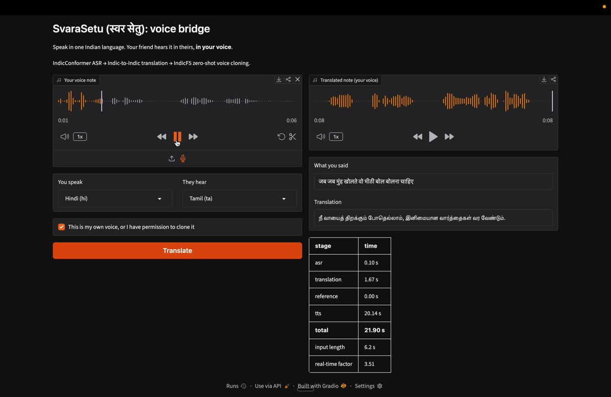

# SvaraSetu: speak Tamil, be heard in Hindi, in your own voice

Record a WhatsApp-style voice note in one Indian language. The listener gets it in their language, **spoken in your voice**.

### Demo (sound on)

[](docs/demo/svarasetu-demo.mp4)

A 6-second Hindi note, *"जब जब मुंह खोलते वो मीठी बोल बोलना चाहिए"* ("whenever you open your mouth, speak sweet words"), comes back in Tamil in the same voice. [Watch the video](docs/demo/svarasetu-demo.mp4); click the image to open it.

```
voice note ─▶ IndicConformer ASR ─▶ Indic→Indic translation ─▶ IndicF5 zero-shot voice cloning ─▶ translated note
 (any 16 kHz+)   (transcript)          (Sarvam or IndicTrans2)     (prompt = best 8 s of your note)
```

Supports 11 languages end to end (the ones IndicF5 can speak): Assamese, Bengali, Gujarati, Hindi, Kannada, Malayalam, Marathi, Odia, Punjabi, Tamil, Telugu, so 110 language pairs.

## How it works

1. **ASR**: [AI4Bharat IndicConformer](https://huggingface.co/ai4bharat/indic-conformer-600m-multilingual) (600M, CTC decoding) transcribes the note.
2. **Translation**: Indic-to-Indic, no English pivot. `sarvam-translate:v1` by default; set `TRANSLATOR=indictrans2` to self-host [IndicTrans2](https://huggingface.co/ai4bharat/indictrans2-indic-indic-dist-320M).
3. **Voice prompt**: silence is trimmed and the most voiced window of up to 8 s is cut out as the cloning prompt. F5 needs the exact words in the prompt, so a cut-down clip is re-transcribed.
4. **TTS**: [IndicF5](https://huggingface.co/ai4bharat/IndicF5) speaks the translation in the prompt voice at 24 kHz, sentence by sentence (split on `।`, `?`, `!`, `.`).
5. Every stage is timed; the UI and API report per-stage latency and real-time factor.

## Evaluation

`voicenote/eval` measures what matters for this task:

| Metric | What it answers | How |
| --- | --- | --- |
| Speaker similarity | Does it still sound like you? | ECAPA-TDNN (SpeechBrain) cosine between input and output, against a cross-speaker baseline |
| Round-trip CER | Is the cloned speech intelligible? | Run IndicConformer on the output in the target language and compare with the text TTS was given |
| chrF | Is the translation right? | Against FLEURS reference sentences (FLEURS is parallel across languages) |
| Latency / RTF | Is it usable? | Per-stage wall-clock time, divided by input length |

```bash
# Build a Tamil→Hindi test set from FLEURS (parallel sentences give reference translations)
python -m voicenote.eval.make_fleurs_manifest --src ta --tgt hi --n 50 --out data/eval
# Run the pipeline and score it; writes results/results.csv, results/summary.md and output audio
python -m voicenote.eval.run_eval data/eval/fleurs_ta-hi.csv --out results/ta-hi
```

### Results: Tamil → Hindi, 20 FLEURS sentences (Kaggle, 1× Tesla T4)

| Metric | Result | How to read it |
| --- | --- | --- |
| Speaker similarity (ECAPA cosine) | **0.70** mean, 0.76 median | Output vs the speaker's own input. Different speakers score **0.23** (cross-speaker baseline), so cloning closes most of the gap |
| Round-trip CER | **3.0%** mean, 1.8% median | IndicConformer reads the cloned Hindi back almost exactly; 19 of 20 notes under 10% |
| Translation chrF | **40.1** | Against FLEURS' independent human Hindi sentences, through an ASR → MT cascade |
| Latency per note | **19.8 s** mean for a 12.3 s note (RTF 1.76) | ASR 0.10 s, translation 1.9 s, voice prompt 0.07 s, **TTS 17.7 s (90%)** |

Observations:
- **TTS is the bottleneck.** IndicF5 runs 32 flow-matching steps per sentence; fewer steps, fp16 or batching sentences are the obvious levers. ASR on ONNX-GPU is effectively free.
- **One clear failure:** one note scored speaker similarity 0.09 with a CER of 0.8%, so the words were right but the voice was not. The cause isn't diagnosed yet; checking that note's voice prompt (length, noise) is the next step.
- Hindi outputs run about 40% shorter than the Tamil inputs (7.1 s vs 12.3 s). Whether that is the language or IndicF5's duration estimate is worth checking against FLEURS' own Hindi recordings.

Per-note results: [`docs/results/fleurs_ta-hi_20.csv`](docs/results/fleurs_ta-hi_20.csv).

## Run it

Needs a Hugging Face token with access to the gated `ai4bharat/IndicF5` model (accept its terms on the model page) and a Sarvam API key. A GPU is strongly recommended.

```bash
pip install -r requirements-voicenote.txt
cat > .env <<EOT
HF_TOKEN=...
SARVAM_API_KEY=...
EOT

python -m voicenote.app                                    # web demo on :7860
uvicorn voicenote.server:app --host 0.0.0.0 --port 8000    # REST API, docs at /docs
```

API example:

```bash
curl -F audio=@note.ogg -F src_lang=ta -F tgt_lang=hi localhost:8000/translate
# → transcript, translation, timings, real_time_factor, audio_wav_base64
```

**On Kaggle (free GPU):** import [`notebooks/kaggle_run.ipynb`](notebooks/kaggle_run.ipynb), turn on a GPU and Internet, add `HF_TOKEN` and `SARVAM_API_KEY` as Kaggle Secrets, and Run All. It runs a smoke test, the FLEURS evaluation, and starts the demo with a public link.

Docker: `docker build -t voicenote . && docker run --gpus all --env-file .env -p 7860:7860 voicenote`

Unit tests use fake models, so they run without a GPU or tokens: `pip install -r requirements-dev.txt && pytest`.

## Responsible use

Voice cloning can be misused. The demo asks the user to confirm the voice is their own or that they have permission to clone it, which follows the IndicF5 model card's guidance.

## Layout

```
voicenote/
  languages.py   language codes across IndicConformer, Sarvam, IndicTrans2
  audio.py       loading, resampling, silence trim, voice-prompt selection
  asr.py         IndicConformer wrapper
  translate.py   Sarvam / IndicTrans2 backends
  tts.py         IndicF5 wrapper with sentence chunking
  pipeline.py    end-to-end orchestration and timings
  server.py      FastAPI REST API
  app.py         Gradio demo
  eval/          metrics, FLEURS manifest builder, evaluation runner
tests/           unit tests with fake models
```

---

## Earlier work: Indic voice-enabled RAG system

This project is an end-to-end voice-enabled conversational system  It integrates Automatic Speech Recognition (ASR), Translation, Vector Retrieval (RAG), and Large Language Models (LLM) to answer voice-based questions.

### Features
- **Task 1: Data Collection**: Wikipedia scraper with ambiguity handling.
- **Task 2: Vector DB**: Section-aware chunking and FAISS vector storage.
- **Task 3: ASR Deployment**: FastAPI server running AI4Bharat's `indic-conformer-600m-multilingual` model.
- **Task 4: Translation**: English translation using Sarvam's official Python SDK.
- **Task 5: RAG Pipeline**: End-to-end integration of all components.
- **Bonus: Chat UI**: Gradio-based web interface for seamless interaction.

---

### Setup Instructions

### 1. Prerequisites
- Python 3.10+
- At least 10GB of free disk space (for the ASR model and dependencies).
- API Keys: Hugging Face (with access to AI4Bharat models) and Sarvam AI.

### 2. Installation
```bash
# Create virtual environment
python3 -m venv venv
source venv/bin/activate

# Install dependencies
pip install -r requirements.txt
```

### 3. Configuration
Create a `.env` file in the root directory:
```env
HF_TOKEN=your_huggingface_token
SARVAM_API_KEY=your_sarvam_api_key
GROQ_API_KEY=your_groq_api_key
```

---

### How to Run

### Step 1: Data Collection & Vector DB
```bash
# Collect data (Example: Cricket)
python phase1_data/datacollection.py "Cricket"

# Chunk and create embeddings
python phase2_vector/chunking.py --input data/raw/Cricket.txt
python phase2_vector/embeddings.py
```

### Step 2: Deploy ASR API
```bash
# This starts the ASR server on port 8000
python -m uvicorn phase3_asr.asr_api:app --host 0.0.0.0 --port 8000
```

### Step 3: Run the Chat UI
```bash
# This starts the Gradio interface
python app.py
```
Visit `http://localhost:7860` in your browser.

---

### Observations & Implementation Details

### 1. Chunking Strategy (Task 2)
- **Chunk Size**: `3500 chars` (~800-1000 tokens). This size is chosen to provide sufficient context to the LLM while staying within common context windows. It ensures that complex Wikipedia sections are captured in their entirety.
- **Overlap**: `400 chars`. Overlapping chunks prevent context loss at boundaries (e.g., a sentence being cut in half) and improve retrieval quality for questions that might bridge two chunks.
- **Justification**: Using section-aware chunking (splitting by Wikipedia headers) ensures that topics are logically grouped before being subdivided, preserving semantic coherence.

### 2. Vector Database (Task 2)
- **Tool**: FAISS (Facebook AI Similarity Search).
- **Benefits**: Extremely fast, lightweight (runs locally), and integrates perfectly with LangChain/HuggingFace embeddings.
- **Drawbacks**: Unlike managed solutions (Qdrant/Pinecone), it is not naturally persistent/scalable as a standalone service without extra management code.

### 3. Challenges Faced
- **Disk Space**: The `indic-conformer` model is quite large (~2.5GB including ONNX assets). Downloading these model files on a full disk caused IO errors, requiring significant cleanup.
- **SDK Compatibility**: Initial attempts to use the REST API for Sarvam translation hit header/authorization issues (403). Switching to the official `sarvamai` Python SDK resolved these and handled language code formatting (e.g., `hi-IN` instead of just `hi`) correctly.
- **ASR Model Loading**: The model requires `onnxruntime` and `torch`, which are heavy dependencies that require specific versions to work smoothly on Mac Silicon (M1/M2/M3).

---

### Technical Constraints & Handling
- **Ambiguity Detection**: The Wikipedia search script includes a `resolve_ambiguity` function to filter out "may refer to" pages and select the most relevant canonical article.
- **Wait for ASR**: The pipeline handles cases where the ASR server might be slow to respond during initial cold start (model loading).
- **LLM Provider**: Switched to Groq with `llama-3.3-70b-versatile` for extremely low-latency and high-quality responses.

---

